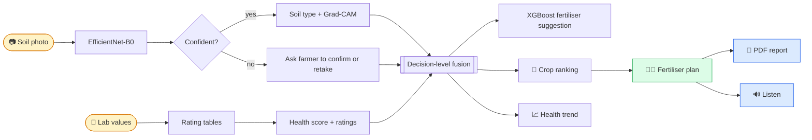
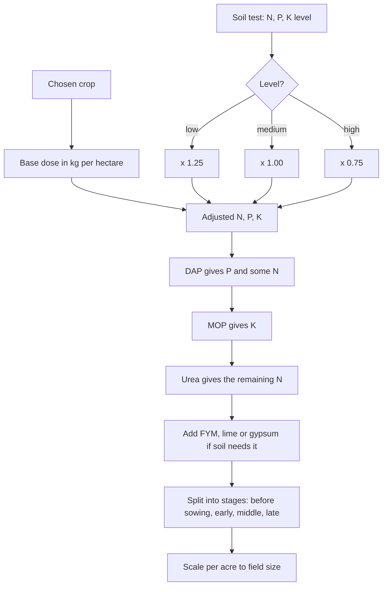
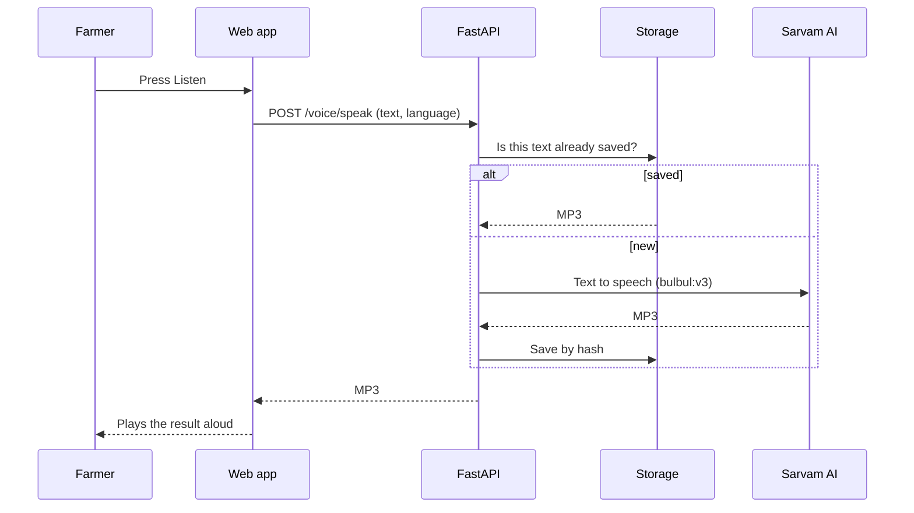
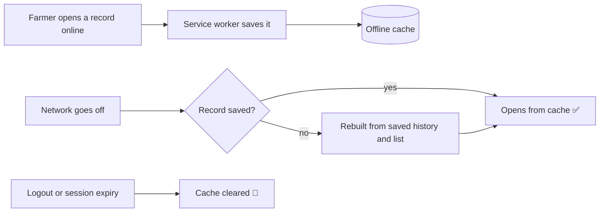
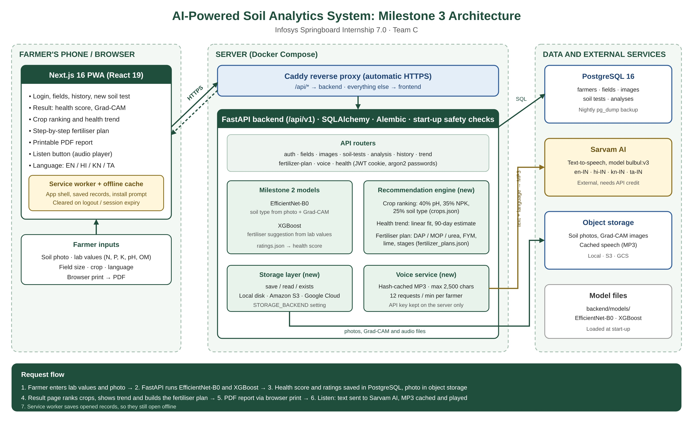
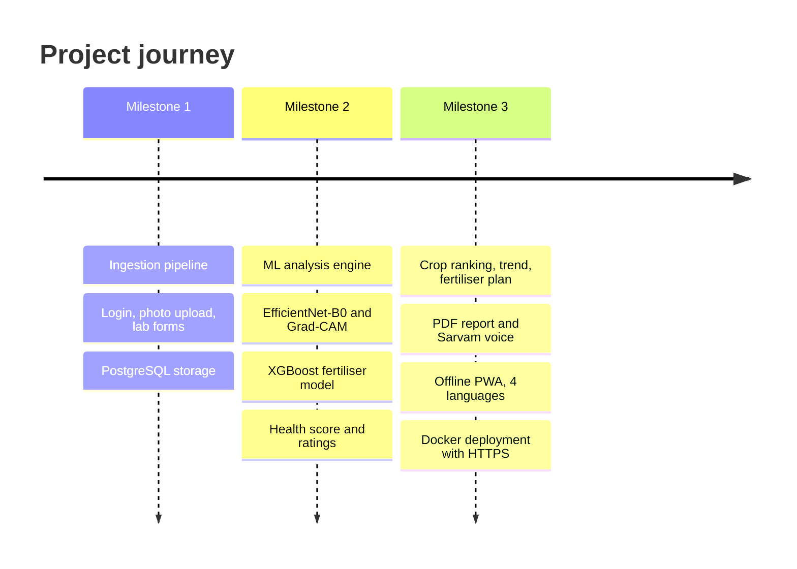
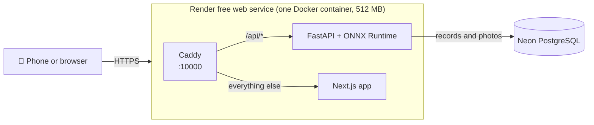

<div align="center">



# 🌱 AI-Powered Soil Analytics System
### Nutrient assessment and intelligent crop advisory for farmers
*Infosys Springboard Internship 7.0 · Team C*

<a href="https://ai-powered-soil-analytics-system-for.onrender.com"></a>

> 💤 **First visit after a quiet period:** the free server sleeps when nobody is using it, so the page can take about a minute to wake up. After that it is fast.

> **A farmer uploads a soil photo and enters lab values. The app finds the soil type, scores soil health, ranks crops, gives a step-by-step fertiliser plan, and speaks the result in the farmer's own language, even with weak internet.**


**[🚀 Live demo](#-live-demo) · [✨ Features](#-features) · [🗺️ How it works](#️-how-it-works) · [🧭 Milestones](#-milestones) · [🚀 Quick start](#-quick-start) · [🔌 API](#-api) · [☁️ Deployment](#️-deployment) · [⚠️ Limits](#️-known-limitations)**

</div>

## 🚀 Live demo

| | |
| --- | --- |
| 🌐 **App** | **<https://ai-powered-soil-analytics-system-for.onrender.com>** |
| 📱 **On a phone** | Open the link in Chrome (Android) or Safari (iPhone) and install it: Chrome menu > *Install app*, or Safari Share > *Add to Home Screen* |
| 🔑 **Try it** | Sign up with any name, a phone number and a password, add a field, upload a soil photo and open the analysis |
| 🌍 **Languages** | Switch between English, हिन्दी, ಕನ್ನಡ and தமிழ் from the top bar |

> Hosted on free tiers (Render for the app, Neon for the database), so please use test data only.

## ✨ Features

| | Feature | What the farmer gets |
| :-: | --- | --- |
| 📷 | **Soil photo analysis** | Soil type from EfficientNet-B0, with a Grad-CAM heat map showing what the model looked at |
| 🧪 | **Health score** | Low / medium / high ratings for N, P, K, pH and organic matter, plus a 0 to 100 score |
| 🌾 | **Crop ranking** | Crops scored for this soil: 40% pH fit, 35% nutrient fit, 25% soil type |
| 📈 | **Health trend** | Improving, steady or declining, with a 90-day estimate (needs 3 or more tests over 14 days) |
| 🧑‍🌾 | **Fertiliser plan** | Step-by-step doses (DAP, urea, MOP, manure, lime) by growth stage, scaled to the field size |
| 📄 | **PDF report** | One-click printable report, including the plan, in all four languages |
| 🔊 | **Listen** | The result read aloud with Sarvam AI voices |
| 📲 | **Installable PWA** | Install from the browser, open saved records offline |
| 🌐 | **4 languages** | English, हिन्दी, ಕನ್ನಡ, தமிழ் on every page |
| 🚀 | **Production ready** | Docker, HTTPS, light ONNX model for small servers, photos in S3, Google Cloud or the database, backup script |


## 🗺️ How it works

<div align="center">

</div>

### 🔬 From soil to advice



<details>
<summary><b>🧑‍🌾 How the fertiliser plan is worked out</b> (click to open)</summary>



- **Manure:** 2,000 kg per acre, or 4,000 kg when organic matter is low.
- **Lime:** 200 kg per acre for acidic soil, 400 kg for strongly acidic soil. **Gypsum** 500 kg per hectare for groundnut.
- Each step is marked **done, now or later**. Coffee and tea use rounds instead of stages.

</details>

<details>
<summary><b>🔊 How Listen works</b> (click to open)</summary>



The Sarvam key stays on the server. Text is limited to 2,500 characters and 12 requests per minute per farmer.

</details>

<details>
<summary><b>📲 How offline use works</b> (click to open)</summary>



Saving new tests, login and Listen still need internet; the app shows an offline banner. The service worker only runs in a production build (`npm run build && npm start`).

</details>

<details>
<summary><b>🖼️ Full architecture diagram</b> (click to open)</summary>



</details>


## 🧭 Milestones



| Milestone | Notes |
| --- | --- |
| 1. Ingestion | Signup and login, photo upload and camera capture, image checks, OpenCV preprocessing, lab forms, PostgreSQL |
| 2. ML analysis | [MILESTONE2.md](MILESTONE2.md) |
| 3. Advisory and product | [MILESTONE3.md](MILESTONE3.md) · [Fertiliser plan](MILESTONE3_PLAN.md) · [Voice](MILESTONE3_VOICE.md) · [PWA and offline](MILESTONE3_PWA.md) · [Deployment](DEPLOYMENT.md) |

## 🧰 Tech stack

| Layer | Tools |
| --- | --- |
| **Backend** | FastAPI, SQLAlchemy 2, Alembic, PostgreSQL 16, argon2 + JWT cookie login |
| **ML** | EfficientNet-B0 trained in PyTorch and served with **ONNX Runtime**, XGBoost, OpenCV, Grad-CAM, SHAP |
| **Frontend** | Next.js 16 (app router), React 19, TypeScript, service worker PWA |
| **Voice** | Sarvam AI text to speech (`bulbul:v3`) |
| **Deployment** | Docker, Caddy, **Render** (free web service) + **Neon** (free PostgreSQL); or Docker Compose on any server; photos in the database / local disk / Amazon S3 / Google Cloud Storage |

## 📁 Project structure

```text
soil-analytics/
├── backend/      FastAPI app, ML services, Alembic migrations, tests
├── frontend/     Next.js PWA
├── ml/           Notebooks and evaluation reports
├── deploy/       Caddyfile and backup script
├── docs/assets/  Images and animations used in the docs
├── docker-compose.yml        PostgreSQL for development
└── docker-compose.prod.yml   Full production stack
```


## 🚀 Quick start

> You need **Python 3.11+**, **Node.js 20+** and **Docker** (for PostgreSQL).

<table>
<tr>
<td width="50%" valign="top">

### 1️⃣ Backend

```bash
docker compose up -d
cd backend
python3 -m venv .venv
source .venv/bin/activate
pip install -r requirements-dev.txt
cp .env.example .env
alembic upgrade head
uvicorn app.main:app --reload
```

API at <http://localhost:8000>

</td>
<td width="50%" valign="top">

### 2️⃣ Frontend

```bash
cd frontend
npm install
npm run dev
```

App at <http://localhost:3000>

**Install and offline test:**

```bash
npm run build
npm start
```

</td>
</tr>
</table>

> 📦 **Model files are not in Git** (they are large). Put `soil_cnn_D_hard_negatives.pt`, `fert_model.joblib` and `inference_config.json` in `backend/models/`, then check <http://localhost:8000/api/v1/analysis/status>.
>
> 🔊 To enable Listen, set `SARVAM_API_KEY` in `backend/.env`.

**Tests**

```bash
cd backend && pytest                 # backend tests
cd frontend && npx tsc --noEmit      # type check
```

<details>
<summary><b>⚙️ Configuration</b> (click to open)</summary>

Copy `backend/.env.example` to `backend/.env`. **Never commit `.env` files.**

| Variable | Purpose |
| --- | --- |
| `DATABASE_URL` | PostgreSQL connection |
| `SECRET_KEY` | Signs login cookies (at least 32 characters in production) |
| `COOKIE_SECURE` | `true` when served over HTTPS |
| `STORAGE_BACKEND` | `local`, `s3` or `gcs` |
| `SARVAM_API_KEY` | Text to speech (optional) |

</details>

## 🔌 API

All routes are under `/api/v1`. Login sets a signed `soil_session` cookie.

<details>
<summary><b>Show all endpoints</b> (click to open)</summary>

| Path | Method | Purpose |
| --- | :-: | --- |
| `/auth/signup`, `/auth/login`, `/auth/logout` | POST | Account and session |
| `/auth/me`, `/auth/me/language` | GET, PATCH, PUT | Profile and language |
| `/fields` | GET, POST | The farmer's fields |
| `/fields/{id}/soil-tests` | GET, POST | Lab values |
| `/fields/{id}/images` | GET, POST | Soil photos |
| `/fields/{id}/analyze` | POST | Run the models and save the analysis |
| `/analyses/{id}` | GET | One analysis |
| `/analyses/{id}/gradcam` | GET | Grad-CAM heat map |
| `/fields/{id}/history` | GET | Past analyses |
| `/fields/{id}/trend` | GET | Health trend and 90-day estimate |
| `/fertilizer-plan/crops` | GET | Crops available for a plan |
| `/analyses/{id}/fertilizer-plan` | GET | Step-by-step plan |
| `/voice/status`, `/voice/speak` | GET, POST | Speech |
| `/analysis/status`, `/health` | GET | Model and service health |

</details>

## ☁️ Deployment

The live app runs for free with **no card**: one Docker container on **Render** (API, web app and a small Caddy front door) and a **Neon** PostgreSQL database.



| Part | Choice | Why |
| --- | --- | --- |
| Image model | **ONNX Runtime** instead of PyTorch | The API needs about 300 MB instead of over 1 GB, so it fits a 512 MB free server. Predictions match the PyTorch model (probabilities within 0.00004). Convert once with `backend/scripts/export_onnx.py` |
| Photos | `STORAGE_BACKEND=db` | The free server's disk is wiped on restart, so photos are kept in PostgreSQL |
| Database | Neon free tier | No card, pauses when idle and wakes on the next request |
| Front door | Caddy inside the container | Routes `/api/*` to the API and the rest to the web app, so login cookies stay on one address |

**Deploy your own copy:** [DEPLOY_RENDER.md](DEPLOY_RENDER.md) (Render + Neon, no card). Other options: [DEPLOY_FREE.md](DEPLOY_FREE.md) (free servers and a laptop demo) and [DEPLOYMENT.md](DEPLOYMENT.md) (full details: HTTPS, S3 or Google Cloud storage, backups).

On your own server with Docker Compose:

```bash
cp .env.prod.example .env.prod       # fill in the values
docker compose --env-file .env.prod -f docker-compose.prod.yml up -d --build
```

Four services start: database, backend, frontend and **Caddy**, which gets an HTTPS certificate automatically. Start-up checks refuse weak settings (short `SECRET_KEY`, insecure cookies, missing bucket).


## ⚠️ Known limitations

- 🧑‍🔬 Rating thresholds, crop ranges and fertiliser doses are **provisional** and need confirmation by an agriculture expert.
- 🗣️ Hindi, Kannada and Tamil text needs native-speaker review.
- 🧮 The fertiliser plan is rule-based and separate from the XGBoost suggestion.
- 💤 The free server sleeps after about 15 minutes without visitors, and the free CPU is small, so the first load and a photo analysis can take from several seconds to about a minute.
- 💾 Photos are stored in the free database (about 1 GB in total), so this setup suits demos, not many users.
- 🔊 Voice (Sarvam) is paid, so the Listen button stays hidden unless an API key is set.
- ☁️ Free tiers can change their terms. The Docker setup in this repository can be moved to any server.

## 👥 Team

**Team C**, Infosys Springboard Internship 7.0 (Batch 4).

<div align="center">


*Made with 💚 for farmers*

</div>
